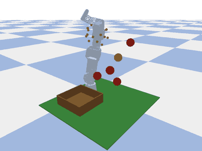

# 达妙七轴 草莓定点到达仿真（WSL2 + PyBullet）

课设《设施草莓采摘仿生机械臂控制系统设计》的定位精度仿真验证部分。**唯一执行基线为同目录《实验指导书_damiao七轴草莓定点到达.md》**。
模型为**达妙科技官方开源七轴谐波机械臂** URDF 派生版（`left_arm_dm`，BSD-3-Clause）；原 xArm6 版本保留在 [xinkaima1/xarm6-reach-lab](https://github.com/xinkaima1/xarm6-reach-lab) 作只读对照基线。

## 范围声明

- 纯仿真；不制实物。**末端执行器为仿真内已有的卷曲仿生章鱼爪演示层**（纯视觉几何体），**不采用达妙官方夹爪**——官方 URDF 的 `tool_link` / `gripper_left` / `gripper_right` 与 `tool_joint` / `gripper_joint1` / `gripper_joint2` 已在派生 URDF 中整段裁剪；
- 不含夹爪开合、采摘接触力学、状态机、视觉/CLIP、力控；
- 精度验证对象只有一件事：**达妙七轴的末端 link（link7）依次到达 5 个写死的空间目标点**，误差口径为 link7 原点（URDF link frame 原点），**不含任何夹爪偏移**；
- 方法为 PyBullet 内置 `calculateInverseKinematics` **位置-only IK**（不约束姿态）+ **位置-only 数值精修**（7 轴冗余下内置求解器远距离初值会停在 3–8 mm 局部解）；
- 仿真动力学为**无重力设定**（`setGravity(0,0,0)`）+ 轨迹段速度前馈，验证轨迹规划与位置伺服的指令跟踪与定位收敛；重力负载前馈补偿属实物化后续工作。达妙实物的静态重力矩已用 numpy 单独校核（J2 峰值 8.83 N·m、J5–J7 裕度约 11 N·m），**该值是静态演算，不是带载精度验证**；
- **演示层抓放循环**：每个草莓点接近时触手先按 rho=a*exp(b*theta) **向后卷曲成对数螺旋**收在末端后方，到达指定坐标时**反向展开**，随后沿果实球面**缠绕包覆夹取**，再移到篮子放果、入篮留存、前往下一点，逐颗循环、放果后回卷待机。触手是 3 根 × 6 段纯视觉体（几何为示意值、非中科大实物参数），不是 URDF 末端执行器、不进运动学链；篮子与果实搬运同样是纯视觉示意：无夹爪、无接触/约束、无夹持力、不约束末端姿态（「低头」以末端位置下降表达），不写入 CSV、不参与两重静态判定与伺服跟踪判定，也不代表抓取成功率或果实识别能力。

## 演示素材（答辩可用）

> 以下动图与图片均由 **2026-11-18 v8 达妙版同一次完整运行**（`results/reach_demo.mp4`，976 帧 / 960×720 / 32.53 s）派生；画面已**抽样判读 6 帧**（第 0/100/200/430/700/975 帧，覆盖卷曲 / 展开 / 缠绕 / 入篮 / 终态），非全量逐帧校验。答辩引用数字一律以 `results/reach_results.csv` 与《实验指导书》v8 §8.3 为准。



**关键帧拼图**（6 帧覆盖起始、接近、展开、缠绕包覆、入篮、终态；PPT 一页讲清全过程）：


| 素材 | 内容 | 规格 | 建议用途 |
|------|------|------|----------|
| `results/reach_demo.gif` | 循环动图，5 颗果实逐颗「卷曲 → 展开 → 缠绕」抓放 | 400×300 / 184 帧 / 160 ms 每帧（≈6.2 fps，循环约 29.4 s）/ 32 色 / 791 KB | README 自动播放、现场快速展示 |
| `results/reach_demo.mp4` | 完整运行录像（含 5 段触手三阶段 + 抓放） | 960×720 / 976 帧 / 30 fps / 32.53 s / 2.7 MB | 答辩现场播放、备用录屏 |
| `results/reach_keyframes.png` | 6 帧拼图（含帧号、时间戳与三阶段中文标签） | 1440×784 / 272 KB | PPT 过程页 |
| `results/scene.png` | 终态截图（篮中 5 颗果实全在篮中） | 960×720 / 29 KB | 结果页配图 |
| `results/reach_results.csv` | 逐点误差与收敛数据（5 行、21 列） | 817 B | 答辩数字唯一来源 |
| `results/run_stats.json` | 实跑统计（帧数、耗时、限位余量、环境版本） | 1.1 KB | 口径自查 |
| `results/target_selection.json` | 目标点选取记录（残差 / 限位余量 / 关节解） | 1.2 KB | 目标点可复算依据 |

**画面语义（答辩务必说清，避免误读）**：红球 = 待到达目标点、黄球 = 当前正在到达的目标、绿球 = 已通过判定的目标；棕色开口箱 = 篮子，绿色薄板为栽培架示意，蓝白棋盘为仿真地面；**橙黄色小段 = 卷曲仿生章鱼爪**（3 根 × 6 段纯视觉体，**在 link7 局部坐标系内生成、随腕部姿态同步，从法兰外侧（局部 +z）伸出**：缠绕环心 = link7 原点 = 被测点/草莓标记位置，触手始终包住果实，不歪出腕部、也不缩回臂体——2026-11-18 用户先后指出「歪」「装反」后两次修正）。触手在接近阶段卷成对数螺旋团收在末端后方，到位后反向展开并沿球面缠绕包覆果实，果实随后随末端移动到篮内并按序留存，终态 5 颗全在篮中。这些球是**位置标记，不是草莓外观或果实模型**；**画面中无官方夹爪 / 无 URDF 末端执行器**，果实搬运为纯视觉移动，**不含抓取接触、夹持力或接触力学**；「低头放果」只是末端位置下降，不约束末端姿态。本轮精度验证的仍是 **link7 原点依次到位**（无重力设定下的轨迹跟踪与定位收敛），不是抓取成功率或果实识别。

**建议口径**：现场播 MP4（或看动图）+ 关键帧拼图讲「梯形轨迹规划 + 位置伺服」两层结构，再说明触手卷曲 / 展开 / 缠绕与抓放循环只是流程可视化；数字只引用 `err_track` **0.000–0.001 mm < 5 mm**、**5/5 收敛**、976 帧 / 渲染 237.0 s；主动声明无重力设定、触手为示意几何、官方夹爪未采用与范围边界（指导书 §0 / §12 / §14）。

## 当前状态（截至 2026-11-18 19:17）

### 已实测

- WSL2 Ubuntu，conda `robot` 环境：Python 3.11.18、pybullet 3.2.7（manylinux cp311 wheel）、numpy 2.4.6、imageio 2.38.1、pillow 13.0.0；
- 工程文件就位：`damiao_reach.urdf`（派生自官方 URDF，8 link / 7 revolute，无夹爪）、`meshes/damiao/{visual,collision}/` 下各 8 个官方 STL（33 MB，原样未改）；
- 派生自检 `derive_damiao_urdf.py`：`== DERIVE PASS ==`（15 个保留块与官方逐字一致、无夹爪残留、无 `package://` 网格引用）；
- 加载自检 `test_load.py`：`== ALL PASS ==`，**7 组官方限位逐项 PASS**、末端 link 名 `link7`（索引按名反查 = 6）、零位 FK `(0.00000, -0.03325, 0.49810)` m（|Δ| 0.000 mm）、帧缓冲 307200 bytes；
- 快速验证 / 负向验证：**5/5 点通过**、负向模式**退出码 2**（P_BAD_H 水平 0.80 m > 0.389 m、P_BAD_Z z=0.80 m ∉ [-0.111, 0.507]，均在 IK 前被预筛拒绝）；
- **完整运行（v8 达妙版 2026-11-18 21:00 → 21:04，末端装反修正后复跑）**：5/5 点到达，`err_ik` / `err_track` **0.000–0.001 mm**（阈值 5 mm 未放宽），`converge_step=59`，限位余量 0.308–0.730 rad，976 帧 @ 960×720，渲染耗时 **245.7 s**，全程 **246.0 s**；`render_time_s=245.7`；演示层 5 段抓放 + 触手卷曲 / 展开 / 缠绕三阶段，放果点 IK 残差 0.00 mm、限位 5/5 OK；`FULL_EXIT=0`；
- MP4 实测可完整解码 976 帧（30 fps / 32.53 s）；画面抽样判读 6 帧：帧 0 卷曲成螺旋团、帧 200 反向展开、帧 430 球面缠绕包住果实、终态篮中 5 颗；派生 GIF（184 帧 / 791 KB）与关键帧拼图（272 KB）已生成并目检已生成并目检。

### 未实测（不得当作结论引用）

- 降级渲染分支（`--res 640x480 --every 16`）的实际耗时；
- `--threshold` 换阈值复跑；
- 全新机器按指导书从零环境复跑（零探索验证）；
- MP4 画面内容的**全量逐帧**人工判读（已完成 6 帧抽样，非全量，不作逐帧正确性结论）；
- **带重力对照运行**（需单独裁决；若做，必须独立脚本 + 独立 CSV，不得与本组无重力数字混报）；
- 真实抓取 / 接触 / 夹持力（均在本实验范围外）。

## 一键复跑

```bash
conda activate robot
cd damiao_reach_lab

python derive_damiao_urdf.py --src \
  ../damiao_7axis_arm/left_arm_dm/src/left_description_grip/urdf/left_description_grip.urdf \
  --dst damiao_reach.urdf          # 模型派生自检，须 DERIVE PASS
python test_load.py                 # 模型加载自检，须 ALL PASS
python select_targets.py            # 可达空间扫描 + 目标点选取（可复算）
python damiao_reach_demo.py --no-video            # 快速验证：只出 CSV + 截图
python damiao_reach_demo.py --check-out-of-range  # 负向验证：预期退出码 2
python damiao_reach_demo.py        # 完整运行：CSV + MP4 + 截图
python make_demo_assets.py          # 由 MP4 派生 GIF 与关键帧拼图
```

固定解释器路径（免激活 conda）：`/home/slphy_kai/miniconda3/envs/robot/bin/python`。脚本依赖相对路径的 URDF / meshes / results，**必须在工程根目录内执行**。

阈值默认 5 mm（`--threshold` 可配）；渲染降级用 `--res 640x480 --every 16`。完整参数含义与数值来源见实验指导书附录 B。

## 目录

| 路径 | 说明 |
|------|------|
| `damiao_reach.urdf` | 达妙官方 URDF 派生版（仅删官方夹爪子树 + 改 mesh 相对路径，几何/惯量/限位逐字未改） |
| `derive_damiao_urdf.py` | 派生脚本（含「保留块与官方逐字一致」强校验） |
| `test_load.py` | 加载自检（关节数 / 7 组限位 / 末端 link 名 / 零位 FK / 渲染通路） |
| `damiao_reach_demo.py` | 主实验：两段式 IK + 梯形轨迹 + 位置伺服 + 章鱼爪演示层 + CSV |
| `select_targets.py` | 可达空间扫描与 5 目标点选取（残差 / 限位余量 / 间距三重约束） |
| `make_demo_assets.py` | 由完整运行录像派生 GIF 与六帧关键帧拼图 |
| `make_damiao_guide.py` | 实验指导书口径转换脚本（保证「文档 = 工程」，内嵌代码与工程文件 md5 一致） |
| `meshes/damiao/visual/` `collision/` | 达妙官方 STL 各 8 个，原样未改 |
| `results/` | 实验产物与演示素材（CSV / MP4 / GIF / 关键帧拼图 / 终态截图 / 统计） |
| `答辩材料/` | 达妙口径报告 md+docx、说明书、口径说明（另保留 xArm6 口径旧版作对照） |
| `实验指导书_damiao七轴草莓定点到达.md` | 唯一执行基线（内嵌 §5 派生脚本 / §6 自检脚本 / §7 主脚本全文） |
| `变更记录_达妙七轴迁移_20261118.md` | 旧值 → 新值 → 原因 → 重跑结果 |
| `README.md` | 本文件 |

## 与 xArm6 版的差异（换臂必改项，13 项已全部重跑）

| 项 | xArm6 版（已废弃） | 达妙七轴版（本工程） |
|---|---|---|
| URDF | 手写 `xarm6_reach.urdf` | 官方派生 `damiao_reach.urdf`（几何/惯量/限位逐字未改） |
| 自由度 / 末端 link | 6 / `link6`（索引硬编码 5） | **7 / `link7`（索引按名反查 = 6）** |
| 零位末端 | (0.207, 0, 0.112) m | **(0, -0.03325, 0.4981) m** |
| 关节限位 | xArm6 官方 6 组 | **官方 7 组** |
| 力矩上限 FORCES | 163.2/163.2/81.6/81.6/30.6/30.6 | **50/50/50/50/12/12/12 N·m** |
| HOME / restPoses | `[0,-0.5,-1.0,0,0.5,0]` | **官方零位 `[0]*7`** |
| 目标点 | 原 P1–P5（残差 146–200 mm，**全部不可达**） | **重选 5 点**（残差 0.000–0.001 mm） |
| 预筛包络 | r ≤ 0.70 m、z ∈ [0.10, 0.75] | **r ≤ 0.389 m、z ∈ [-0.111, 0.507]** |
| IK | 内置单次，固定 HOME 初值 | **内置粗解 + 位置-only 数值精修**，初值 = 上一点实际关节角 |
| CSV | q1–q6（20 列） | **q1–q7（21 列）** |
| 演示层 | 3 根 × 6 段触手三阶段 + 抓放循环 | **原样保留**（常量与函数逐字不动，仅挂载点索引换为实测 link7 索引） |
| 旧实跑数字 | 0.29–0.88 mm / 133.3 s / 20 列 | **已废弃**，标注「xArm6 基线（已废弃）」 |

## 许可与来源

- 达妙官方开源七轴臂 `left_arm_dm`：**BSD-3-Clause**（软件部分）；**机械图纸无独立 LICENSE**，商业分发前需向作者确认。
- 中科大 OpenSpiRobs（章鱼手参数来源）：PolyForm-Noncommercial，**仅课程使用**；官方无卷曲态/6 臂阵列原生 STEP，不得冒充。
- 本仓库内 16 个 STL 均为官方原始文件，**未作任何修改**。
- 关联仓库：[xinkaima1/xarm6-reach-lab](https://github.com/xinkaima1/xarm6-reach-lab)（原 xArm6 版，只读对照基线）；本仓库 Release `v8.2-damiao-7axis` 附仿真产物包。
