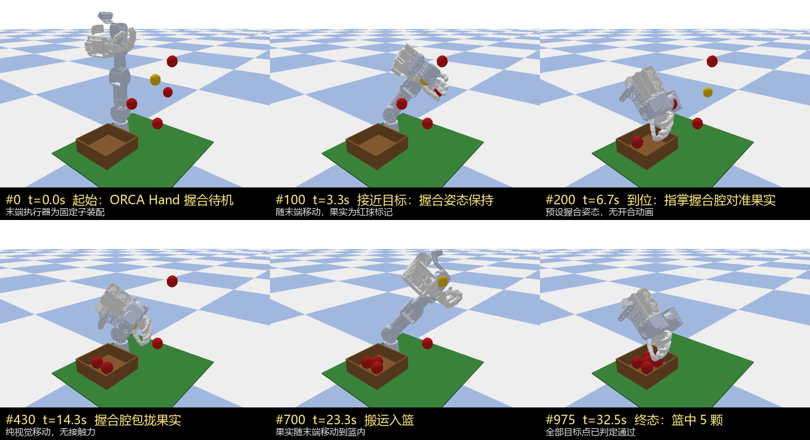

# 达妙七轴 草莓定点到达仿真（WSL2 + PyBullet，v8.3 ORCA Hand 末端执行器版）

课设《设施草莓采摘仿生机械臂控制系统设计》的定位精度仿真验证部分。**唯一执行基线为同目录《实验指导书_damiao七轴草莓定点到达.md》（v8.3）**。
模型为**达妙科技官方开源七轴谐波机械臂** URDF 派生版（`left_arm_dm`，BSD-3-Clause）；**末端执行器为 ORCA Hand 官方 URDF 几何**（`srl-ethz/orcahand_description`，MIT License）固定子装配；原 xArm6 版本保留在 [xinkaima1/xarm6-reach-lab](https://github.com/xinkaima1/xarm6-reach-lab) 作只读对照基线，v8.2 达妙七轴版见 Release `v8.2-damiao-7axis`。

## 范围声明

- **课设立论为仿生机械臂本体的定位精度验证；末端执行器为可替换模块**。v8.2 采用卷曲仿生章鱼爪纯视觉演示层，v8.3 改用 ORCA Hand 官方 URDF 几何（固定子装配），**两者均不参与精度判定**；
- **末端执行器（v8.3）**：几何与关节结构取自 ORCA Hand 官方描述仓库（MIT），以 fixed joint `joint_orca_wrist` 挂接于 `link7` 之后，**惯量置零以维持 v8.2 无重力轨迹跟踪基线，不代表带载精度**；17 个 revolute **锁定为预设握合姿态**（均在官方限位内；官方 URDF 未建模腱绳耦合——无 mimic/transmission——本仿真不含腱绳驱动、接触力学与夹持力）；collision mesh 原样保留于 URDF 但运行时碰撞过滤屏蔽（不参与仿真接触）；**不进 IK 链、不改 5 个目标点、不改误差口径**；
- **仿真不采用达妙官方夹爪**——官方 URDF 的 `tool_link` / `gripper_left` / `gripper_right` 与 `tool_joint` / `gripper_joint1` / `gripper_joint2` 已在派生 URDF 中整段裁剪；
- 不含夹爪开合、采摘接触力学、状态机、视觉/CLIP、力控；
- 精度验证对象只有一件事：**达妙七轴的末端 link（link7）依次到达 5 个写死的空间目标点**，误差口径为 link7 原点（URDF link frame 原点），**不含任何夹爪偏移**；
- 方法为 PyBullet 内置 `calculateInverseKinematics` **位置-only IK**（不约束姿态）+ **位置-only 数值精修**（7 轴冗余下内置求解器远距离初值会停在 3–8 mm 局部解）；
- 仿真动力学为**无重力设定**（`setGravity(0,0,0)`）+ 轨迹段速度前馈，验证轨迹规划与位置伺服的指令跟踪与定位收敛。达妙实物的静态重力矩已用 numpy 单独校核（v8.2 演算，J2 峰值 8.83 N·m、J5–J7 裕度约 11 N·m，**未含末端负载**）；v8.3 另有 `--with-orca-mass` 带载对照实验（含 ORCA 官方质量 1.135 kg 的静态持重力矩 PyBullet 实算），**两套数字独立记录、禁止混报**；
- **演示层抓放循环**：每个草莓点到达判定通过后，果实随末端搬到篮子放果点、末端下降示意「低头放果」、果实入篮留存、前往下一点，逐颗循环。**果实搬运是纯视觉移动**：无接触/约束、无夹持力、不约束末端姿态、不写入 CSV、不参与两重静态判定与伺服跟踪判定，**不代表抓取成功率或果实识别能力**；
- v8.2 的卷曲章鱼爪演示层保留为 `--legacy-tentacle` 分支（默认关闭），保证 v8.2 可复现。

## 版本边界

| 版本 | 内容 | 状态 |
|---|---|---|
| v8.1 | UFACTORY xArm6 六轴（旧，只读对照） | `xarm6-reach-lab` 仓库 |
| v8.2 | 达妙科技开源七轴谐波臂 + 章鱼爪演示层 | Release `v8.2-damiao-7axis`（保持原样不动） |
| **v8.3（本版）** | **达妙七轴 + ORCA Hand 官方 URDF 末端执行器** | Release `v8.3-orcahand` |

**数字口径**：本 README 的 5/5 通过、0.000–0.001 mm、976 帧 / 265.4 s 等均为 **2026-11-18 v8.3 重跑实测**（`results/reach_results.csv` 与 `results/run_stats.json`）；v8.2 的历史数字（976 帧 / 237.0 s 等）仅存于其 Release 与 §14.1–14.6 历史记录，不与本版混引。

## 演示素材（答辩可用）

> 以下动图与图片均由 **2026-11-18 v8.3 同一次完整运行**（`results/reach_demo.mp4`，976 帧 / 960×720 / 32.53 s）派生；画面已**抽样判读 6 帧**（第 0/100/200/430/700/975 帧，覆盖待机 / 接近 / 到位 / 包拢 / 入篮 / 终态），非全量逐帧校验。答辩引用数字一律以 `results/reach_results.csv` 与《实验指导书》v8.3 §8.3 为准。


**关键帧拼图**（6 帧覆盖起始、接近、到位、包拢、入篮、终态；PPT 一页讲清全过程）：



| 素材 | 内容 | 规格 | 建议用途 |
|------|------|------|----------|
| `results/reach_demo.gif` | 循环动图，5 颗果实逐颗到达 / 搬运入篮（ORCA Hand 呈现） | 400×300 / 178 帧 / 160 ms 每帧（≈6 fps，循环约 28.5 s）/ 32 色 / 888 KB | README 自动播放、现场快速展示 |
| `results/reach_demo.mp4` | 完整运行录像（ORCA Hand 固定子装配） | 960×720 / 976 帧 / 30 fps / 32.53 s / 4.2 MB | 答辩现场播放、备用录屏 |
| `results/reach_demo_legacy_tentacle.mp4` | v8.2 章鱼爪复现分支抽样录像（320×240 / 每 16 步） | 491 帧 / 54.3 s 渲染 | `--legacy-tentacle` 分支可复现的证据 |
| `results/reach_keyframes.png` | 6 帧拼图（含帧号、时间戳与中文标签） | 1440×784 / 307 KB | PPT 过程页 |
| `results/scene.png` | 终态截图（篮中 5 颗果实） | 960×720 / 37 KB | 结果页配图 |
| `results/reach_results.csv` | 逐点误差与收敛数据（5 行、21 列） | 817 B | 答辩数字唯一来源 |
| `results/run_stats.json` | 实跑统计（帧数、耗时、限位余量） | 638 B | 口径自查 |
| `results/target_selection.json` | 目标点选取记录（残差 / 限位余量 / 关节解，v8.3 复算与 v8.2 一致） | 1.2 KB | 目标点可复算依据 |
| `results/reach_results_orca_mass.csv` | **带载对照独立 CSV**（`--with-orca-mass`，禁止与无重力基线混报） | 820 B | 带载口径查证 |

**画面语义（答辩务必说清，避免误读）**：红球 = 待到达目标点、黄球 = 当前正在到达的目标、绿球 = 已通过判定的目标；棕色开口箱 = 篮子，绿色薄板为栽培架示意，蓝白棋盘为仿真地面；**末端白灰色灵巧手 = ORCA Hand 官方 URDF 几何**（固定子装配，掌面向上托果、预设握合姿态、握合腔对准果实标记，**无开合动画**）。这些球是**位置标记，不是草莓外观或果实模型**；果实搬运为纯视觉移动，**不含抓取接触、夹持力或接触力学**；「低头放果」只是末端位置下降，不约束末端姿态。本轮精度验证的仍是 **link7 原点依次到位**（无重力设定下的轨迹跟踪与定位收敛），不是抓取成功率或果实识别能力。

**建议口径**：现场播 MP4（或看动图）+ 关键帧拼图讲「梯形轨迹规划 + 位置伺服」两层结构，再说明末端执行器是可替换模块、ORCA Hand 为官方 URDF 几何的固定子装配；数字只引用 `err_track` **0.000–0.001 mm < 5 mm**、**5/5 收敛**、976 帧 / 渲染 265.4 s；主动声明无重力设定、ORCA 惯量置零、腱绳耦合未建模、范围边界（指导书 §0 / §12 / §14.7）。

## 当前状态（截至 2026-11-18 22:16）

### 已实测（v8.3，2026-11-18）

- WSL2 Ubuntu，conda `robot` 环境：Python 3.11.18、pybullet 3.2.7（manylinux cp311 wheel）、numpy 2.4.6、imageio 2.38.1、pillow 13.0.0；
- 工程文件就位：`damiao_reach.urdf`（达妙官方派生 8 link / 7 revolute + ORCA 子装配 42 link / 41 fixed + 1 挂接 fixed = **50 link / 49 joint**）、`meshes/damiao/{visual,collision}/` 各 8 个官方 STL（33 MB）、`meshes/orcahand/{visual,collision}/` 各 34 个官方 STL（7.1 MB，均原样未改）；
- 派生自检 `derive_orcahand_urdf.py`：`== ORCA DERIVE PASS ==`（68 处 mesh 路径改写全部可达、惯量置零、17 个 revolute 锁定预设握合姿态、83 个块与官方展开结果一致、无 `package://` 残留、无 mimic/transmission）；
- 派生自检 `derive_damiao_urdf.py`：`== DERIVE PASS ==`（达妙 15 个保留块与官方逐字一致、无夹爪残留、ORCA 子装配 42 link / 41 fixed + 1 挂接 joint 校验通过）；
- 加载自检 `test_load.py`：`== ALL PASS ==`，**7 组官方限位逐项 PASS**、末端 link 名 `link7`（索引按名反查 = 6）、零位 FK `(0.00000, -0.03325, 0.49810)` m（|Δ| 0.000 mm）、ORCA 惯量置零 / 碰撞过滤 / 包围盒断言 PASS（0.256×0.100×0.081 m，零位最低点 0.438 m 不与地面穿模）、帧缓冲 307200 bytes；
- 目标点复算 `select_targets.py`：5 点坐标与残差**与 v8.2 记录逐位一致**；
- 快速验证 / 负向验证：**5/5 点通过**、负向模式**退出码 2**（P_BAD_H 水平 0.80 m > 0.389 m、P_BAD_Z z=0.80 m ∉ [-0.111, 0.507]，均在 IK 前被预筛拒绝）；
- **完整运行（v8.3 2026-11-18 22:16）**：5/5 点到达，`err_ik` / `err_track` **0.000–0.001 mm**（阈值 5 mm 未放宽），`converge_step=59`，限位余量 **0.308–0.730 rad**，976 帧 @ 960×720，渲染耗时 **265.4 s**，全程 **266.0 s**；`render_time_s=265.435`；演示层 5 段抓放，放果点 IK 残差 0.00 mm、限位 5/5 OK；`FULL_EXIT=0`；
- **`--legacy-tentacle` 分支**：快速验证 5/5 通过；降分辨率抽样渲染（320×240 / 每 16 步，491 帧 / 54.3 s）确认章鱼爪三阶段动画完整（`results/reach_demo_legacy_tentacle.mp4`）；
- **`--with-orca-mass` 带载对照**（独立口径）：`--no-video` 快速验证 5/5 通过（独立 CSV `results/reach_results_orca_mass.csv`），重力 9.81 m/s² + ORCA 官方质量 1.135 kg，逐点**静态持重力矩 PyBullet 实算**峰值 J1 0.000 / J2 7.910 / J3 2.680 / J4 2.899 / J5 0.860 / J6 0.354 / J7 0.838 N·m；完整渲染未执行；
- MP4 实测可完整解码 976 帧（30 fps / 32.53 s）；画面抽样判读 6 帧正常（标注为抽样、非全量）；派生 GIF（178 帧 / 888 KB）与关键帧拼图（307 KB）已生成并目检。

### 未实测（不得当作结论引用）

- 降级渲染分支（`--res 640x480 --every 16`）在默认模式下的实际耗时；
- `--threshold` 换阈值复跑；
- `--with-orca-mass` 带载对照的完整渲染（仅完成快速验证）；
- 全新机器按指导书从零环境复跑（零探索验证）；
- MP4 画面内容的**全量逐帧**人工判读（已完成 6 帧抽样，非全量，不作逐帧正确性结论）；
- **带重力纯臂对照运行**（不带 ORCA 质量；需单独裁决，若做必须独立脚本 + 独立 CSV，不得与本组无重力数字混报）；
- ORCA 腱绳耦合建模、真实接触抓取 / 夹持力（均在本实验范围外）。

## 一键复跑

```bash
conda activate robot
cd damiao_reach_lab

python third_party/orcahand/expand_orcahand_xacro.py   # v8.3：ORCA 官方 xacro 展开（可复算）
python derive_orcahand_urdf.py --src third_party/orcahand/orcahand_right.urdf \
  --dst third_party/orcahand/orcahand_right_sim.urdf   # ORCA 仿真派生，须 ORCA DERIVE PASS
python derive_damiao_urdf.py --src \
  ../damiao_7axis_arm/left_arm_dm/src/left_description_grip/urdf/left_description_grip.urdf \
  --dst damiao_reach.urdf                              # 达妙派生 + ORCA 子装配追加，须 DERIVE PASS
python test_load.py                 # 模型加载自检，须 ALL PASS（含 ORCA 断言）
python select_targets.py            # 可达空间扫描 + 目标点选取（可复算）
python damiao_reach_demo.py --no-video            # 快速验证：只出 CSV + 截图（统计写 run_stats_no_video.json）
python damiao_reach_demo.py --check-out-of-range  # 负向验证：预期退出码 2
python damiao_reach_demo.py        # 完整运行：CSV + MP4 + 截图（默认 ORCA Hand；最后跑，覆盖主 CSV）
python make_demo_assets.py          # 由 MP4 派生 GIF 与关键帧拼图
python make_damiao_guide.py         # 重生成实验指导书（内嵌代码与工程文件 md5 一致）
```

可选开关：`--legacy-tentacle`（v8.2 章鱼爪复现分支）、`--with-orca-mass`（带载对照实验：重力 + ORCA 官方质量，独立 CSV，**数字不与无重力基线混报**）。

固定解释器路径（免激活 conda）：`/home/slphy_kai/miniconda3/envs/robot/bin/python`。脚本依赖相对路径的 URDF / meshes / results，**必须在工程根目录内执行**。

阈值默认 5 mm（`--threshold` 可配）；渲染降级用 `--res 640x480 --every 16`。完整参数含义与数值来源见实验指导书附录 B。

## 目录

| 路径 | 说明 |
|------|------|
| `damiao_reach.urdf` | 达妙官方 URDF 派生版 + ORCA Hand 子装配（达妙部分几何/惯量/限位逐字未改） |
| `derive_damiao_urdf.py` | 达妙派生脚本（含「保留块与官方逐字一致」强校验 + ORCA 子装配追加与校验） |
| `derive_orcahand_urdf.py` | v8.3 新增：ORCA Hand 仿真专用派生脚本（mesh 路径改写 / 惯量置零 / revolute 锁定 + 强校验） |
| `third_party/orcahand/` | ORCA 官方 xacro（原样）、展开脚本、展开 URDF、仿真派生 URDF、MIT LICENSE 副本 |
| `test_load.py` | 加载自检（关节数 / 7 组限位 / 末端 link 名 / 零位 FK / ORCA 断言 / 包围盒 / 渲染通路） |
| `damiao_reach_demo.py` | 主实验：两段式 IK + 梯形轨迹 + 位置伺服 + ORCA 演示层 + CSV + run_stats 自动回填 |
| `select_targets.py` | 可达空间扫描与 5 目标点选取（残差 / 限位余量 / 间距三重约束） |
| `make_demo_assets.py` | 由完整运行录像派生 GIF 与六帧关键帧拼图（ORCA 口径标签，`--legacy-tentacle` 可切换旧标签） |
| `make_damiao_guide.py` | 实验指导书口径转换脚本（保证「文档 = 工程」，内嵌代码与工程文件 md5 一致） |
| `meshes/damiao/{visual,collision}/` | 达妙官方 STL 各 8 个，原样未改 |
| `meshes/orcahand/{visual,collision}/` | ORCA 官方 STL 各 34 个，原样未改 |
| `results/` | 实验产物与演示素材（CSV / MP4 / GIF / 关键帧拼图 / 终态截图 / 统计 / 带载对照独立 CSV） |
| `答辩材料/` | 达妙口径报告 md+docx、说明书、口径说明（本次未改动） |
| `实验指导书_damiao七轴草莓定点到达.md` | 唯一执行基线 v8.3（内嵌派生脚本 / 自检脚本 / 主脚本全文） |
| `实验指导书_xarm6草莓定点到达.md` | 旧版对照（只读） |
| `变更记录_达妙七轴迁移_20261118.md` | v8.2 变更记录（保持原样） |
| `变更记录_ORCA末端执行器_v8.3_20261118.md` | v8.3 变更记录（旧值 → 新值 → 原因 → 重跑结果） |
| `RELEASE_NOTES_v8.3.md` | Release `v8.3-orcahand` 说明 |
| `README.md` | 本文件 |

## 与 v8.2 的差异（只换末端执行器，臂本体不变）

| 项 | v8.2（达妙七轴 + 章鱼爪） | v8.3（达妙七轴 + ORCA Hand） |
|---|---|---|
| 末端执行器 | 卷曲仿生章鱼爪纯视觉演示层（不在 URDF 内） | **ORCA Hand 官方 URDF 几何**（fixed 挂接 `joint_orca_wrist`） |
| 模型文件 | 8 link / 7 revolute | **50 link / 49 joint**（+42 ORCA link、+41 fixed、+1 挂接 fixed，不引入可动关节） |
| ORCA 口径 | — | 惯量置零、17 个 revolute 锁定预设握合姿态、碰撞过滤屏蔽、不进 IK 链 |
| 演示层 | 章鱼爪三阶段（默认） | **默认 = ORCA 握合呈现**；章鱼爪保留为 `--legacy-tentacle` 分支 |
| 带载对照 | 无 | 新增 `--with-orca-mass`（独立 CSV + 静态持重力矩实算） |
| 达妙臂主体 / 目标点 / 判据 / 限位 / IK / CSV 字段 | — | **均不变** |
| 实跑数字（v8.3 重跑） | 976 帧 / 237.0 s（v8.2 实测，已废弃不作本轮引用） | **976 帧 / 265.4 s / 5/5 / 0.000–0.001 mm** |

## 许可与来源

- 达妙官方开源七轴臂 `left_arm_dm`：**BSD-3-Clause**（软件部分）；**机械图纸无独立 LICENSE**，商业分发前需向作者确认；
- **ORCA Hand 描述文件 `srl-ethz/orcahand_description`：MIT License**（本工程使用的 URDF/xacro 与 68 个 STL 来源）；硬件制造包 `orcahand/orca_files`：**CC BY 4.0，仅作参考、无 URDF、本工程不使用**；
- 中科大 OpenSpiRobs（章鱼手参数来源）：PolyForm-Noncommercial，**仅课程使用**（因 `--legacy-tentacle` 分支仍保留，仅课程演示使用）；
- 仓库内 16 个达妙 STL 与 68 个 ORCA STL 均为官方原始文件，**未作任何修改**；
- ORCA 官方 URDF 未建模腱绳耦合（无 mimic/transmission）；官方未公开的指标（额定负载、重复精度、法兰、通信协议等）一律标「待核实」，不冒充官方数据；
- 关联仓库：[xinkaima1/xarm6-reach-lab](https://github.com/xinkaima1/xarm6-reach-lab)（原 xArm6 版，只读对照基线）；本仓库 Release `v8.2-damiao-7axis`（保持原样）、`v8.3-orcahand`（本版）附仿真产物包。
